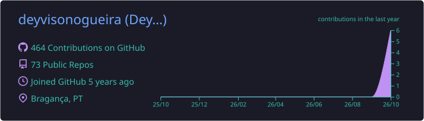
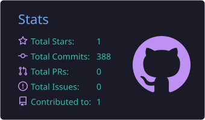
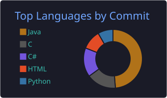

<p align="center">
  
</p>

<p align="center">
  <a href="https://github.com/deyvisonogueira">
    
  </a>
</p>

<p align="center">
  <a href="https://www.linkedin.com/in/deyvisonogueira/"></a>
  <a href="mailto:deyvisonogueira@gmail.com"></a>
  <a href="https://orcid.org/0009-0002-5725-9526"></a>
  <a href="https://instagram.com/deyvisonogueira"></a>
</p>

---

### `> whoami`

Most AI projects die in a notebook. Most enterprise systems never meet AI.  
**I work right where those two worlds collide.**

By day, I keep invoices, purchase orders and fiscal documents flowing through **SAP** for large companies. In my research, I taught a neural network to **estimate a cow's weight from one smartphone photo**, and then shipped it as a working web app.

If you need someone who understands both the business process and the model behind it, **let's talk.**

```python
class Deyvison:
    role       = "SAP Functional Analyst"
    research   = "Computer Vision for Livestock · MSc (dual degree PT/BR)"
    based_in   = "Bragança, Portugal"
    stack      = ["Python", "PyTorch", "scikit-learn", "ONNX", "Flask", "SAP", "ABAP", "Ruby"]
    superpower = "turning messy real-world problems into processes that just work"

    def currently(self):
        return [
            "defending my MSc thesis",
            "review paper under peer review",
            "automating consulting work with AI",
        ]
```

---

### `> why_work_with_me`

| 🔗 **Two worlds, one person** | 🧪 **Rigor over hype** | 🚀 **Idea to production** |
|:--|:--|:--|
| Enterprise processes (SAP MM, fiscal, integrations) **and** modern AI. I speak both languages, so nothing gets lost in translation. | Per-animal splits and 5-fold cross-validation with paired tests. I report the number that holds up, not the one that looks best. | From raw data to a model exported to ONNX and a live web app. Not just a notebook: something people can use. |

---

### `> featured_research`

**🐄 Computer vision for non-invasive cattle weight estimation**  
*MSc dissertation · Polytechnic University of Bragança × IF Sul de Minas · PECOViSiA project*

Weighing cattle on a scale is expensive, slow and stressful for the animal. I tested how far **one ordinary photo** can go.

- 📊 **24.4 kg** mean error (MAPE 15.8%) with ResNet18, under strict five-fold, per-animal cross-validation
- ⚖️ Benchmarked **ResNet, EfficientNet, MobileNetV3, view fusion, segmentation and tree ensembles** on the same protocol
- 💡 Key insight: with ~1,500 animals, the bottleneck is the **data**, not the architecture
- 🌐 Shipped as a **web prototype** (ONNX + Flask) that estimates weight from a single photo
- 📄 Review article *"Computer vision and artificial intelligence for non-invasive cattle weight estimation: A review"*, under review at **Smart Agricultural Technology** (Elsevier)

---

### `> tech_stack`

<p>
  
  
  
  
  
  
</p>
<p>
  
  
  
  
  
  
</p>
<p>
  
  
  
</p>

---

### `> git_stats`

<p align="center">
  
</p>
<p align="center">
  
  
</p>
<p align="center">
  
</p>

---

<p align="center">
  <b>Working on applied AI, agritech or SAP + AI?</b><br>
  I'm always up for a good problem. <a href="https://www.linkedin.com/in/deyvisonogueira/">Send me a message</a> ☕
</p>

<p align="center">
  
</p>
